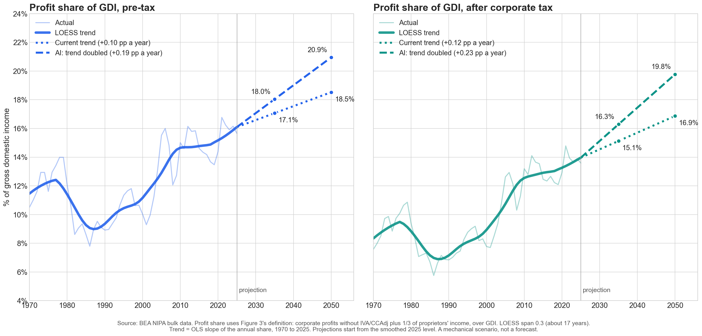

# AI Scenario: The Profit Share in 2035 and 2050

*Companion to the [main note](README.md), November 2026. Code: [`scripts/ai_trend_projection.py`](scripts/ai_trend_projection.py). Data: [`data/ai_trend_projection.csv`](data/ai_trend_projection.csv).*

If AI doubles the 1970–2025 trend, the pre-tax profit share reaches 18.0% of GDI by 2035 and 20.9% by 2050, compared with 17.1% and 18.5% on the current trend. After corporate tax, the doubled trend gives 16.3% by 2035 and 19.8% by 2050, compared with 15.1% and 16.9%. These are mechanical extrapolations of a past trend, not forecasts.



---

## Method

The share uses Figure 3's definition of the profit (capital) share: corporate profits (without IVA/CCAdj) plus one third of proprietors' income, divided by GDI, before tax and after corporate tax. Annual data for 1970–2025 come from BEA's NIPA bulk file (dated 4 November 2026).

```
S(t) = S(2025) + m × b × (t − 2025)
```

- **S(t)**: projected profit share in year t, as % of GDI.
- **S(2025)**: the smoothed share in 2025, which is the starting level: 16.1% pre-tax and 14.0% after corporate tax. The actual 2025 values are 15.7% and 13.6%.
- **b**: the trend, measured as the OLS slope of the annual share on the year over 1970–2025, in percentage points (pp) a year. It is 0.097 pre-tax (90% interval 0.051 to 0.143) and 0.116 after corporate tax (90% interval 0.078 to 0.154). The intervals use Newey-West standard errors with 3 lags, which allow for some persistence in the share from year to year.
- **m**: 1 for the current trend, 2 for the AI scenario.

The smoother is LOESS, a moving local regression ([Cleveland 1979](https://doi.org/10.1080/01621459.1979.10481038)), with a window of 30% of the sample, about 17 years. It sets the starting level without the 2025 cyclical swing. The trend b comes from the raw annual data.

---

## Reading the Numbers

- For the pre-tax share, the doubled trend (0.19 pp a year) matches the pace since 2000 (0.19 pp a year). The AI scenario is therefore close to the 2000–2025 pace continuing for another 25 years. After corporate tax, the pace since 2000 (0.20 pp a year) is a little below the doubled trend (0.23).
- The 90% intervals for 2050 under the AI scenario run from 18.7% to 23.2% pre-tax and from 17.9% to 21.7% after corporate tax. They cover uncertainty in the trend only, not year-to-year shocks around it, so the range of plausible outcomes is wider.
- The after-tax trend includes the past fall in corporate tax as a share of GDI. Future tax changes would move the after-tax line regardless of AI.
- The profit share excludes rental income and net interest, as in Figure 3. Labor's share is not projected.

---

## Replication

```bash
python3 scripts/ai_trend_projection.py
```

Uses the same BEA bulk file as [`POST_TAX.md`](POST_TAX.md) and prints every number cited above. Requires matplotlib, numpy, and statsmodels.

## References

- Cleveland, W. S. (1979). Robust locally weighted regression and smoothing scatterplots. *Journal of the American Statistical Association*, 74(368), 829–836.
- Gollin, D. (2002). Getting income shares right. *Journal of Political Economy*, 110(2), 458–474.
- Newey, W. K., and West, K. D. (1987). A simple, positive semi-definite, heteroskedasticity and autocorrelation consistent covariance matrix. *Econometrica*, 55(3), 703–708.
