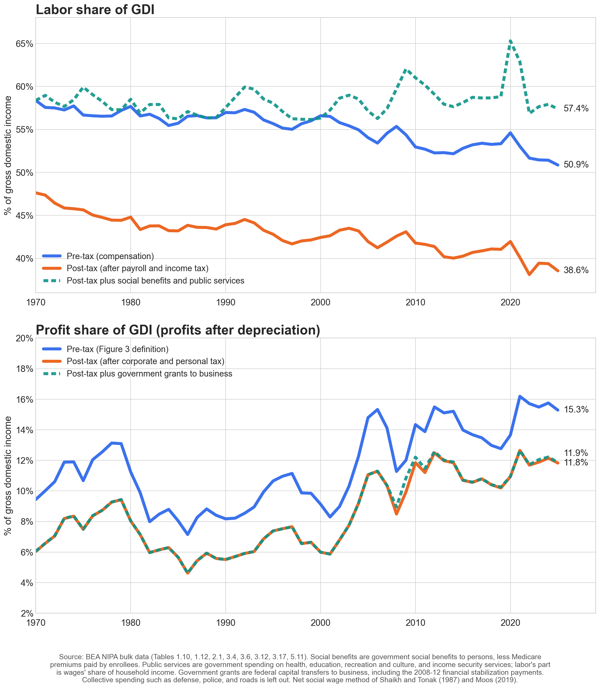

# Labor's Share Before and After Tax and Government Spending

*Companion to the [main note](README.md), November 2026. Code: [`scripts/post_tax_labor_share.py`](scripts/post_tax_labor_share.py) and [`scripts/post_spending_shares.py`](scripts/post_spending_shares.py). Data: [`data/post_tax_labor_share.csv`](data/post_tax_labor_share.csv) and [`data/post_spending_shares.csv`](data/post_spending_shares.csv).*

After payroll and income taxes, labor's share of gross domestic income (GDI) fell from 47.6% in 1970 to 39.4% in 2024, a fall of 8.2 percentage points (pp), against 6.9 pp before tax. Taxes add 1.3 pp to the fall: payroll taxes rose from 4.0% to 5.7% of GDI, while income tax on wages fell slightly. Over the same years the profit share of GDI (profits after depreciation) rose 6.3 pp before tax and 6.1 pp after tax.

Adding back what each side receives from government spending changes the labor result but not the profit result. Counting the social benefits people receive, such as Social Security, Medicare, and Medicaid, and labor's part of public services such as schools, labor's share of GDI was 58.4% in 1970 and 57.9% in 2024. Profits after taxes, plus government grants to business, doubled from 6.0% to 12.2% of GDI ([details below](#after-taxes-and-government-spending)).

[](figures/labor_share_post_tax.png?raw=true)

*Click the figure to open it full size, or see the [PDF](figures/labor_share_post_tax.pdf).*

---

## Results, 1970 and 2024

| % of GDI | 1970 | 2024 | Change (pp) |
|---|---|---|---|
| Labor, pre-tax | 58.4 | 51.4 | −6.9 |
| Labor, post-tax (after payroll and income tax) | 47.6 | 39.4 | −8.2 |
| Profits after depreciation, pre-tax | 9.4 | 15.8 | +6.3 |
| Profits after depreciation, post-tax (after corporate and personal tax) | 6.0 | 12.1 | +6.1 |

Changes are computed from unrounded data. As a share of labor and profit income together, profits rose from 13.9% to 23.5% before tax and from 11.3% to 23.6% after tax. Post-tax profits rose slightly less than pre-tax profits because personal income tax on dividends and on the capital part of proprietors' income rose by more than corporate income tax fell.

---

## Definitions

All measures divide by GDI, as in Figures 1 to 3 of the main note.

```
Pre-tax labor share  = Compensation / GDI
Post-tax labor share = (Compensation − Payroll taxes − Income tax on wages) / GDI
Income tax on wages  = τ × Wages and salaries
τ = Personal income taxes / (Wages + Proprietors' income + Rental income + Interest + Dividends)
```

- **Compensation**: compensation of employees, which includes wages, salaries, employer-paid benefits, and employer contributions for social insurance (BEA Table 1.10). This is the numerator of the main note's headline labor share.
- **Payroll taxes**: employer and employee contributions for government social insurance, mainly Social Security and Medicare, plus unemployment insurance and railroad retirement (BEA Table 3.6). Employer contributions also include small insurance-type items such as workers' compensation and pension-guaranty premiums, about 0.1% of GDI. We exclude contributions by the self-employed, whose income is not in compensation, and Medicare supplementary medical insurance premiums, which enrollees (mostly people aged 65 and over) pay.
- **τ**: the average income tax rate on household income, following [Mendoza, Razin and Tesar (1994)](https://doi.org/10.1016/0304-3932(94)90021-3), a widely used method for splitting personal income tax between labor and capital income in national accounts. Personal income taxes are federal plus state and local income taxes paid by persons (BEA Table 3.4); the denominator is household income from BEA Table 2.1. τ was 13.0% in 1970 and 14.9% in 2024.

For profits we use Figure 3's definition: corporate profits after depreciation (without IVA/CCAdj, BEA Table 1.12) plus the capital part of proprietors' income, over GDI. Each year proprietors' income is split between labor and capital in the same ratio as the rest of the economy's income, the "economy-wide basis" of Kravis (1959); the capital part was 18.7% of proprietors' income in 1970 and 27.2% in 2024. Post-tax profits subtract corporate income tax and τ times dividends received by persons and the capital part of proprietors' income, so profits carry the same average household income tax rate that wages carry. Figure 3 of the main note subtracts corporate income tax only.

---

## Payroll Taxes as Deferred Pay

Taxes pay for spending, and the post-tax shares above add none of it back; the [next section](#after-taxes-and-government-spending) does. Payroll taxes fund Social Security and Medicare. Social Security benefits rise with a worker's own covered earnings, and Medicare eligibility depends on years of covered work, so workers get something back for these taxes. Payroll taxes that buy benefits workers value act less like a tax and more like part of pay (Summers 1989). Treating them that way, and subtracting only income tax on wages, labor's share fell 6.5 pp, slightly less than the 6.9 pp pre-tax decline. The steeper after-tax decline therefore rests on counting payroll taxes as a pure tax.

---

## After Taxes and Government Spending

[](figures/shares_post_spending.png?raw=true)

*Click the figure to open it full size, or see the [PDF](figures/shares_post_spending.pdf).*

This section adds to each post-tax share what that side receives from government. For labor it follows the "net social wage" of Shaikh and Tonak (1987), the benefits workers receive from government minus the taxes they pay, which Moos ([2018](https://peri.umass.edu/wp-content/uploads/joomla/images/publication/WP453.pdf), [2019](https://doi.org/10.1177/0486613419848097)) extends to 2012. For profits it adds the grants government pays to business.

| % of GDI | 1970 | 2024 | Change (pp) |
|---|---|---|---|
| Labor, post-tax | 47.6 | 39.4 | −8.2 |
| + Social benefits, less Medicare premiums | 6.6 | 14.7 | +8.1 |
| └ Social Security | 2.9 | 4.9 | +2.0 |
| └ Medicare, less premiums | 0.6 | 3.3 | +2.7 |
| └ Medicaid | 0.5 | 3.2 | +2.7 |
| └ Other benefits | 2.6 | 3.3 | +0.7 |
| + Labor's part of public services | 4.1 | 3.8 | −0.3 |
| = Labor, after taxes and spending | 58.4 | 57.9 | −0.5 |
| Profits after depreciation, post-tax | 6.0 | 12.1 | +6.1 |
| + Government grants to business | 0.0 | 0.1 | +0.1 |
| = Profits, after taxes and grants | 6.0 | 12.2 | +6.2 |

Changes are computed from unrounded data. Grants were 0.01% of GDI in 1970 and 0.07% in 2024.

Labor's share after taxes and spending barely changed, because social benefits rose by 8.1 pp of GDI, almost as much as the post-tax share fell (8.2 pp). Social Security, Medicare, and Medicaid account for 7.4 pp of that rise. The share jumps in recessions, when benefits rise and incomes fall, and it peaked at 65.3% in 2020, when pandemic relief raised benefits. Profits still doubled: after taxes and grants, they rose from 9.4% to 17.4% of labor and profit income together.

In 1970 what labor received from these programs (10.7% of GDI) almost exactly matched the payroll and income taxes it paid (10.7%). That fits Shaikh and Tonak's series, whose net social wage averaged about zero from 1959 to 1997 (Moos 2018, Table 1). By 2024 labor received 18.5% of GDI and paid 12.0%. Moos (2019) also finds more redistribution to workers from 2002 on.

```
Labor after taxes and spending = Post-tax labor share + Social benefits + s × Public services
Profits after taxes and grants = Post-tax profits + Government grants to business
s = Wages / (Wages + Proprietors' income + Rental income + Interest + Dividends)
```

- **Social benefits**: government social benefits to persons (BEA Table 3.12), less the Medicare premiums enrollees pay (Table 3.6). They include Social Security, Medicare, Medicaid, unemployment insurance, veterans' benefits, food stamps (SNAP), and refundable tax credits such as the Earned Income Tax Credit. As in Shaikh and Tonak, all of it counts as labor's. Retirees' Social Security and Medicare count as deferred pay, since both depend on past work, and the rest counts as support for workers and their families when they are out of work, disabled, or on low incomes. Medicare and Medicaid are valued at what government pays for the care, as in [Piketty, Saez and Zucman (2018](https://doi.org/10.1093/qje/qjx043), p. 572). Shaikh and Tonak leave out veterans' benefits; we keep them, because military pay is part of compensation.
- **Public services**: government consumption spending on education, health (public hospitals, clinics, and public health), recreation and culture, and income security services such as running benefit programs (BEA Table 3.17). Households use these services directly. Labor's part is s, wages' share of household income, the same ratio that splits income tax in the post-tax measure, so taxes and services are split alike. s was 72.1% in 1970 and 62.8% in 2024. Shaikh and Tonak split these services by employee compensation's share of personal income, and Piketty, Saez and Zucman (2018, p. 572) split public education in proportion to income. Counting all public services as labor's gives 60.0% in 1970 and 60.2% in 2024; counting none of them gives 54.2% and 54.1%.
- **Government grants**: federal capital transfers to business (BEA Table 5.11), including the 2008–2012 financial stabilization payments, counted in the year paid, as benefits are. They reached 0.9% of GDI in 2009; outside the 2008–2012 bailout years they never exceeded 0.17%. Subsidies and tax breaks need no adjustment, because they are already in profits.

What the measure leaves out:

- **Collective spending**: defense, police and courts, roads and other economic affairs, general administration, and interest on the public debt are left out of both shares. Little is known about who benefits from them (Piketty, Saez and Zucman 2018, p. 572), so any split is an assumption. Piketty, Saez and Zucman share them out in proportion to income, and Shaikh and Tonak count part of spending on transportation, energy, and natural resources as labor's.
- **The rest of public services**: the part used by households living on capital income is left out of both shares.
- **How spending is paid for**: benefits count when paid, however they are financed. Federal deficits pay for part of them, and the labor share does not subtract the sales, excise, and property taxes households pay, which also fund them.
- **Ageing and medical prices**: a growing share of benefits goes to retirees rather than to people working now, so the measure rises as the population ages even if current workers' pay does not. Medicare and Medicaid are valued at cost, so rising medical prices raise it whether or not care improves.
- **The self-employed**: social benefits include those paid to retired self-employed people, whose earnings are not in compensation.
- **Grants before 2018**: a grant cut the tax value of the assets it paid for, so firms deducted less depreciation on them. Our profit measure uses tax depreciation, so it may already include part of those grants, spread over the assets' lives, and adding them when paid could count that part twice. Grants other than the bailout payments never exceeded 0.17% of GDI, so this matters little.

---

## Robustness and Data Notes

- **Capital gains tax.** τ spreads all personal income tax, including tax on realized capital gains, across wages and capital income, so some capital gains tax lands on wages. Removing the Treasury's figures for taxes on capital gains ([Office of Tax Analysis, 2016](https://home.treasury.gov/system/files/131/Taxes-Paid-on-Capital-Gains-for-Returns-with-Positive-Net-Capital-Gains-12202016.pdf), available for 1954–2014) raises the post-tax labor share by 0.2 pp in 1970 and by up to 0.8 pp in later years. The 1970–2024 after-tax decline would then be about 7.6 to 8.0 pp rather than 8.2 pp, still steeper than the pre-tax decline.
- **Data vintage.** All numbers come from BEA's NIPA bulk file dated 4 November 2026.

---

## Replication

```bash
python3 scripts/post_tax_labor_share.py
python3 scripts/post_spending_shares.py
```

The scripts read BEA's data from [`data/bea_nipa_extract.csv`](data/bea_nipa_extract.csv) (sources in [`data/README.md`](data/README.md)) and print every number cited above. Requires matplotlib.

## References

- Kravis, I. B. (1959). Relative income shares in fact and theory. *American Economic Review*, 49(5), 917–949.
- Mendoza, E. G., Razin, A., and Tesar, L. L. (1994). Effective tax rates in macroeconomics: Cross-country estimates of tax rates on factor incomes and consumption. *Journal of Monetary Economics*, 34(3), 297–323.
- Moos, K. A. (2018). Neoliberal redistributive policy: The U.S. net social wage in the 21st century. PERI Working Paper 453, University of Massachusetts Amherst. Working paper version of Moos (2019).
- Moos, K. A. (2019). Neoliberal redistributive policy: The US net social wage in the early twenty-first century. *Review of Radical Political Economics*, 51(4), 581–605.
- Piketty, T., Saez, E., and Zucman, G. (2018). Distributional national accounts: Methods and estimates for the United States. *Quarterly Journal of Economics*, 133(2), 553–609.
- Shaikh, A., and Tonak, E. A. (1987). The welfare state and the myth of the social wage. In R. Cherry et al. (eds.), *The Imperiled Economy, Book I: Macroeconomics from a Left Perspective*. Union for Radical Political Economics.
- Summers, L. H. (1989). Some simple economics of mandated benefits. *American Economic Review*, 79(2), 177–183.
- U.S. Department of the Treasury, Office of Tax Analysis (2016). Taxes paid on capital gains for returns with positive net capital gains, 1954–2014.
