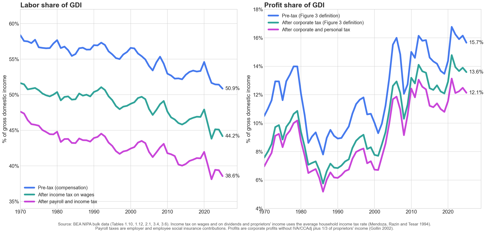

# Labor's Share Before and After Tax

*Companion to the [main note](README.md), November 2026. Code: [`scripts/post_tax_labor_share.py`](scripts/post_tax_labor_share.py). Data: [`data/post_tax_labor_share.csv`](data/post_tax_labor_share.csv).*

After payroll and income taxes, labor's share of gross domestic income (GDI) fell from 47.6% in 1970 to 39.4% in 2024, a decline of 8.2 percentage points (pp). Before tax it fell 6.9 pp, from 58.4% to 51.4%. Taxes therefore add 1.3 pp to the decline, and all of it comes from payroll taxes, which rose from 4.0% of GDI in 1970 to about 6.5% by 1990. Since 1990 the after-tax share has fallen less than the pre-tax share (−4.5 pp against −5.5 pp).



---

## Definitions

All measures divide by GDI, as in Figures 1 to 3 of the main note.

```
Pre-tax labor share  = Compensation / GDI
Post-tax labor share = (Compensation − Payroll taxes − Income tax on wages) / GDI
Income tax on wages  = τ × Wages and salaries
τ = Personal income taxes / (Wages + Proprietors' income + Rental income + Interest + Dividends)
```

- **Compensation**: compensation of employees, which includes wages, salaries, employer-paid benefits, and employer contributions for social insurance (BEA Table 1.10). This is the numerator of the main note's headline labor share.
- **Payroll taxes**: employer and employee contributions for government social insurance, mainly Social Security and Medicare, plus unemployment insurance and railroad retirement (BEA Table 3.6). Employer contributions also include small insurance-type items such as workers' compensation and pension-guaranty premiums, about 0.1% of GDI. We exclude contributions by the self-employed, whose income is not in compensation, and Medicare supplementary medical insurance premiums, which enrollees (mostly people aged 65 and over) pay.
- **τ**: the average income tax rate on household income, following [Mendoza, Razin and Tesar (1994)](https://doi.org/10.1016/0304-3932(94)90021-3), a widely used method for splitting personal income tax between labor and capital income in national accounts. Personal income taxes are federal plus state and local income taxes paid by persons (BEA Table 3.4); the denominator is household income from BEA Table 2.1. τ was 13.0% in 1970 and 14.9% in 2024.

For profits we use Figure 3's definition: corporate profits (without IVA/CCAdj, BEA Table 1.12) plus one third of proprietors' income, over GDI. "After corporate tax" uses the same definition as Figure 3's post-tax line, with values from BEA's current data file. "After corporate and personal tax" also subtracts τ times dividends received by persons and one third of proprietors' income, so profits carry the same average household income tax rate that wages carry.

---

## Results, 1970 to 2024

Labor, as % of GDI:

- Pre-tax labor share: 58.4% to 51.4% (−6.9 pp).
- After payroll and income tax: 47.6% to 39.4% (−8.2 pp).
- Payroll taxes: 4.0% to 5.7% of GDI. Most of the rise came by 1990, when they reached 6.5%; they have fallen back since.
- Income tax on wages: 6.7% to 6.3% of GDI.

Profits, as % of GDI:

- Pre-tax profit share: 10.5% to 16.2% (+5.6 pp).
- After corporate tax: 7.6% to 13.9% (+6.3 pp). Corporate income tax fell from 2.9% to 2.3% of GDI.
- After corporate and personal tax: 7.0% to 12.5% (+5.5 pp). Personal tax on dividends and proprietors' capital income rose from 0.6% to 1.4% of GDI as dividends grew from 2.3% to 7.3% of GDI, which more than offsets the fall in corporate tax.

The profit/wage split:

- The combined shift from labor to profits was 12.6 pp of GDI before tax (−6.9 and +5.6) and 13.8 pp after all taxes (−8.2 and +5.5).
- Profits' share of labor plus profit income rose from 15.3% to 23.9% before tax and from 12.8% to 24.1% after tax.

---

## What This Does Not Count

Taxes pay for spending, and none of it is added back here. Payroll taxes fund Social Security and Medicare. Social Security benefits rise with a worker's own covered earnings, and Medicare eligibility depends on years of covered work, so workers get something back for these taxes. Payroll taxes that buy benefits workers value act less like a tax and more like part of pay (Summers 1989). Treating them that way, and subtracting only income tax on wages, labor's share fell 6.5 pp (51.6% to 45.1%), slightly less than the 6.9 pp pre-tax decline, and the combined shift to profits is 12.0 pp. The steeper after-tax decline therefore rests on counting payroll taxes as a pure tax.

Other transfers and public services are not counted either. Allocating them requires distributional national accounts, which assign taxes and government spending to individuals rather than to labor and capital income ([Piketty, Saez and Zucman 2018](https://doi.org/10.1093/qje/qjx043)).

---

## Robustness and Data Notes

- **Capital gains tax.** τ spreads all personal income tax, including tax on realized capital gains, across wages and capital income, so some capital gains tax lands on wages. Removing the Treasury's figures for taxes on capital gains ([Office of Tax Analysis, 2016](https://home.treasury.gov/system/files/131/Taxes-Paid-on-Capital-Gains-for-Returns-with-Positive-Net-Capital-Gains-12202016.pdf), available for 1954–2014) raises the post-tax labor share by 0.2 pp in 1970 and by 0.5 to 0.8 pp in 2000, 2007, and 2014. If 2024 resembles those years, the 1970–2024 after-tax decline is about 7.6 to 8.0 pp rather than 8.2 pp, still steeper than the pre-tax decline.
- **Data vintage.** All numbers come from BEA's NIPA bulk file dated 4 November 2026. On this vintage the 2024 pre-tax labor share is 51.4%; the main note's 51.9% uses an earlier vintage. The 2025 figures are 50.9% pre-tax and 38.6% after tax.

---

## Replication

```bash
python3 scripts/post_tax_labor_share.py
```

The script downloads BEA's NIPA bulk file on first run (no API key; ~12 MB, saved to `data/bea_raw/`, which git ignores) and prints every number cited above. Requires matplotlib.

## References

- Gollin, D. (2002). Getting income shares right. *Journal of Political Economy*, 110(2), 458–474.
- Mendoza, E. G., Razin, A., and Tesar, L. L. (1994). Effective tax rates in macroeconomics: Cross-country estimates of tax rates on factor incomes and consumption. *Journal of Monetary Economics*, 34(3), 297–323.
- Piketty, T., Saez, E., and Zucman, G. (2018). Distributional national accounts: Methods and estimates for the United States. *Quarterly Journal of Economics*, 133(2), 553–609.
- Summers, L. H. (1989). Some simple economics of mandated benefits. *American Economic Review*, 79(2), 177–183.
- U.S. Department of the Treasury, Office of Tax Analysis (2016). Taxes paid on capital gains for returns with positive net capital gains, 1954–2014.
