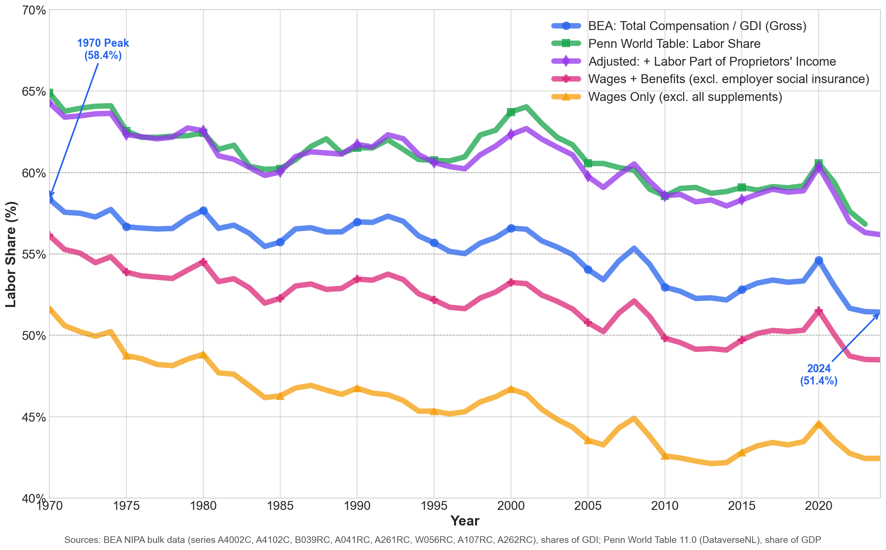
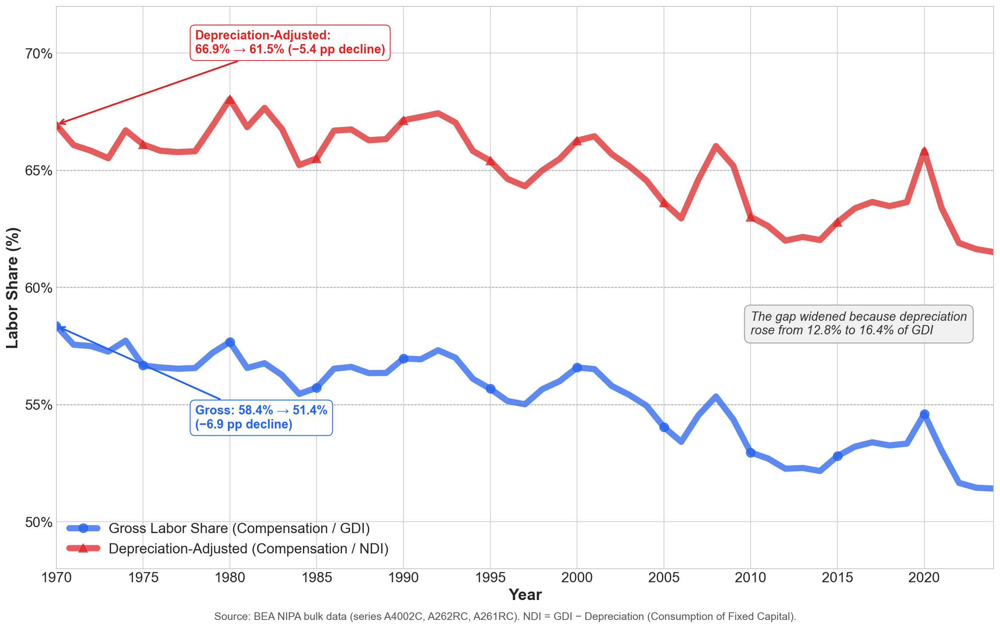
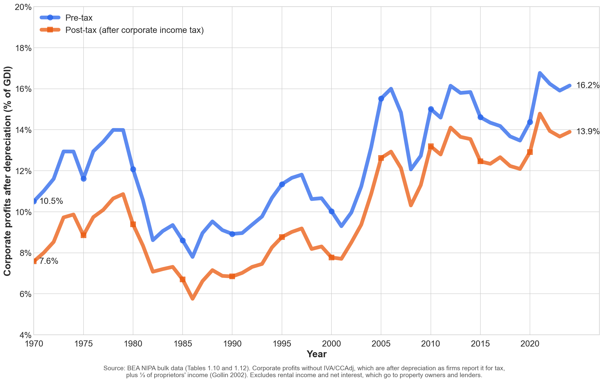
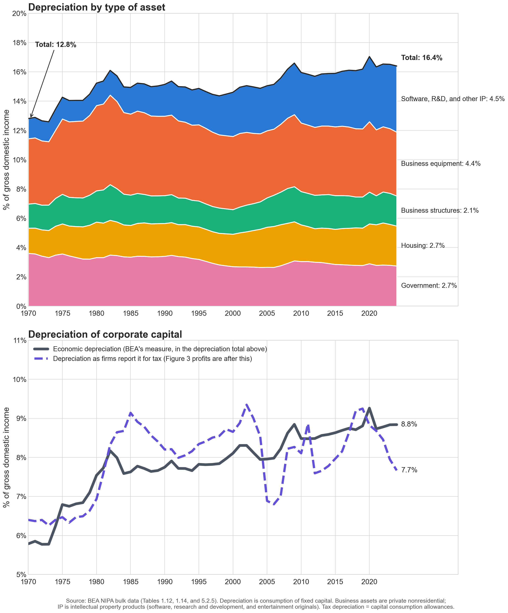

# Has the U.S. Labour Share Declined? A note (v.3)

## Executive Summary

**U.S. labor share declines while profit share grows** Yes! Across the standard BEA whole-economy measures in Table 1.11, the labor share is well below its late-1960s/1970 peak. The decline is consistent across all measures examined here, though magnitude varies with methodological choices. Concurrent to this has been a dramatic rise in the profit share of the income (which excludes interest income and rental income). 

**The rise of profits and depreciation.** It should be noted that the profit share of income (profits after depreciation) remains only 13.5% post-tax (or 15.8% pre-tax) and is now close to the depreciation share of income (16.4%). Depreciation is income set aside by the firm to replace the value of its fixed capital as it declines in productivity. 

**So who is benefiting from the decline in the labor share?** Depreciation income does not really represent income available to the firm as profits. As such the profit share measure deducts depreciation. It also means as the economy's production becomes more machine-intensive, the depreciation share of income will continue to rise, especially as the life of its assets decline. Depreciation, therefore, arguably represents a share of income that does not benefit anyone per se. However, if the price of capital goods falls sharply (as with computing hardware) then depreciation may not grow in value terms even as machinery become more important to production.

### Key Findings (1970-2024)

| Measure | 1970 | 2024 | Change (pp) | Change (%) |
|---------|------|------|-------------|------------|
| **Labor Share** (Compensation/GDI) | 58.4% | 51.4% | **−6.9 pp** | **−12%** |
| **Corporate Profit Share, Pre-Tax** (after depreciation) | 9.4% | 15.8% | **+6.3 pp** | **+67%** |
| **Corporate Profit Share, Post-Tax** (after depreciation) | 6.5% | 13.5% | **+7.0 pp** | **+107%** |
| **Depreciation** | 12.8% | 16.4% | **+3.6 pp** | **+28%** |

**Definitions:**
- **Labor Share** = Compensation of Employees / Gross Domestic Income. Compensation includes wages, salaries, and employer-paid benefits (health insurance, pensions, payroll taxes).
- **Corporate Profit Share** = (Corporate Profits + Capital Part of Proprietors' Income) / GDI. Corporate profits as reported by BEA are **already net of depreciation** — depreciation is deducted as a cost at the firm level before profits are reported. We add the capital part of proprietors' income, the return on the self-employed's business assets. Each year, proprietors' income is split between labor and capital in the same ratio as the rest of the economy's income (compensation against net operating surplus other than proprietors' income), the "economy-wide basis" of Kravis (1959) ([Elsby, Hobijn and Şahin 2013](https://www.brookings.edu/articles/the-decline-of-the-u-s-labor-share/)). The capital part was 18.7% of proprietors' income in 1970 and 27.2% in 2024. Pre-tax uses profits before corporate income tax; post-tax subtracts corporate taxes. Both **exclude** rental income (3.6% of GDI) and net interest (1.9%), which go to property owners and lenders respectively.
- **Depreciation** = Consumption of Fixed Capital / GDI. This is an accounting allowance for capital wearing out — not income to anyone. As the economy shifted toward short-lived assets ([BEA depreciates](https://apps.bea.gov/national/pdf/BEA_depreciation_rates.pdf) software at 33–55% a year, against 2–3% for office and commercial buildings), depreciation's share rose.

*Source: BEA NIPA Tables 1.10 and 1.12, from BEA's bulk data file of 4 November 2026 (saved in [`data/`](data/)), computed by the scripts in [`scripts/`](scripts/). Changes are computed from unrounded data, so they can differ by 0.1 from the gap between the rounded values.*

*Numbers updated November 2026. The March 2026 version differed for three reasons. First, BEA's 2026 annual update revised recent years, mainly 2023 and 2024, lowering the 2024 labor share from 51.9% to 51.4% of GDI and depreciation from 16.5% to 16.4%; earlier years did not change. Second, Figure 3's profit and proprietors' income values had been typed in by hand and did not match BEA's data: for example, 7.2% of GDI for 1980 pre-tax profits, against 10.0% in BEA's data, and 7.8% for 1970 proprietors' income, against 7.3%; all numbers now come from BEA. Third, proprietors' income is now split each year in the same ratio as the rest of the economy's income, where earlier versions gave two-thirds to labor, a common split since Johnson (1954) ([Krueger 1999](https://doi.org/10.1257/aer.89.2.45)). Because labor's fraction fell from 81% in 1970 to 73% in 2024, this raises the 1970–2024 rise in the profit share from 5.6 pp to 6.3 pp before tax and from 6.3 pp to 7.0 pp after corporate tax, and the fall in the adjusted labor share (Figure 1) from 7.4 pp to 8.1 pp (`data/proprietors_income_split.csv` has the split for every year).*

**Key takeaway:** Labor's share of GDI fell by 6.9 pp. GDI is the sum of compensation, depreciation, net operating surplus, and production taxes less subsidies, so the other three shares rose by 6.9 pp in total: depreciation by 3.6 pp and net operating surplus (profits, proprietors' income, rent, and net interest) by 5.1 pp, while production taxes less subsidies fell by 1.7 pp (components rounded). Depreciation, which represents capital maintenance costs that are not income to anyone, thus matches just over half of labor's fall. The 7.0 pp rise in post-tax corporate profits (after depreciation) is measured differently and is not one of these components, so it cannot be added to the rise in depreciation (see Figure 3).

**Sector scope:** This analysis uses **whole-economy GDI shares**. The [BLS nonfarm business sector](https://fred.stlouisfed.org/series/PRS85006173) — which excludes government, nonprofits, and owner-occupied housing — shows an even steeper labor share decline (about 15% from its 1970 peak to 2024).

---

## Defining the Labor Share

The "labor share" is the fraction of national income that accrues to workers as compensation for their labor, as opposed to capital owners (profits, interest, rent). This section defines the key concepts.

### The Basic Definition

The **gross labor share** is defined as:

```
                    Compensation of Employees
Gross Labor Share = ─────────────────────────────
                    Gross Domestic Income (GDI)
```

This is the standard measure used in the literature ([Karabarbounis & Neiman 2014](https://www.nber.org/papers/w19136), [Autor et al. 2020](https://www.nber.org/papers/w23396), [Elsby et al. 2013](https://www.brookings.edu/articles/the-decline-of-the-u-s-labor-share/)).

### What Goes Into the Numerator?

**Compensation of Employees** (BEA series A4002C, NIPA Table 1.10) includes:

1. **Wages and Salaries**: Cash payments to workers before personal income taxes
2. **Supplements to Wages and Salaries**:
   - *Employer contributions for employee pension and insurance funds* (~6% of GDI): Health insurance, 401(k) contributions, life insurance
   - *Employer contributions for government social insurance* (~3% of GDI): Dominated by Social Security and Medicare payroll contributions (FICA, ~7.65% of wages), plus other government social insurance programs (unemployment insurance, workers' compensation, etc.)

This is a **pre-personal-income-tax** measure of total labor cost to employers. It does *not* include the employee's portion of FICA or personal income taxes — those are paid out of wages received.

### What Goes Into the Denominator?

**Gross Domestic Income (GDI)** is the sum of all incomes earned in production. At the **Table 1.11 level**, the identity is:

```
GDI = Compensation of Employees
    + Net Operating Surplus (NOS)
    + Taxes on Production and Imports less Subsidies
    + Consumption of Fixed Capital (Depreciation)
```

Where **Net Operating Surplus** is itself composed of:
- Corporate Profits (with IVA and CCAdj)
- Proprietors' Income
- Rental Income of Persons
- Net Interest and Miscellaneous Payments
- two small items: business current transfer payments and the current surplus of government enterprises

"Net Interest" is interest paid by businesses minus the interest they receive, making it smaller than gross interest flows in the economy.

We use GDI rather than GDP because the labor share numerator (compensation) comes from the income side of the accounts. Using GDP would mix income-side numerators with expenditure-side denominators, introducing measurement noise from the statistical discrepancy.

### Note on Gross vs. Net Measures

**Our primary findings use Gross Domestic Income (GDI) as the denominator**, which is the standard in the literature. An alternative approach uses Net Domestic Income (NDI = GDI − Depreciation), which excludes capital maintenance costs.

From a distributional standpoint, NDI is arguably more relevant for understanding "who benefits" since depreciation is not income available to anyone — it represents resources set aside to replace worn-out capital. However, gross measures are more directly comparable across studies and represent total economic output.

Figure 2 compares both measures. See **Appendix A** for full NDI methodology.

### Alternative Numerator Definitions

We also examine alternative numerator definitions to isolate different components:

| Numerator | What It Measures | Interpretation |
|-----------|------------------|----------------|
| **Total Compensation** | Wages + all supplements | Total cost of employing labor |
| **Wages + Benefits (excl. employer social insurance)** | Wages + employer pension/insurance | Excludes employer payroll taxes |
| **Wages Only** | Cash wages before taxes | Excludes all non-cash compensation |

The choice of numerator matters: wages alone have fallen more steeply than total compensation because rising employer benefits and payroll taxes have partially offset wage stagnation.

---

## Figures

*Click any figure to open it full size.*

### Figure 1. Labor Share Declined Across All Measures Since 1970 Peak

[](figures/labor_share_gross.png?raw=true)

Figure 1 shows five different ways of measuring labor's share of national income, all using GDI as the denominator but varying the labor income numerator (the top of the equation). Each line represents a different definition of "labor income."

- **BEA Total Compensation**: Blue line. The standard gross labor share. The numerator is total compensation of employees (wages + supplements). This is the benchmark measure used in most academic literature.

- **Wages + Benefits (excl. employer social insurance)**: Pink line. The numerator excludes employer contributions for government social insurance (~3% of GDI, dominated by FICA) while keeping private benefits.

- **Penn World Table (1970–2023 only)**: Green line. Uses a different methodology that imputes a labor share for self-employed workers, rather than treating proprietors' income as mixed. *Note: PWT data ends in 2023; the line does not extend to 2024.*

- **Adjusted: Includes the Labor Part of Proprietors' Income**: Purple line. Adds the labor part of proprietors' income to the numerator, to account for the pay of the self-employed for their own work. Each year proprietors' income is split in the same ratio as the rest of the economy's income, so the labor part was 81.3% of proprietors' income in 1970 and 72.8% in 2024. This line fell from 64.3% to 56.2%, 8.1 pp.

- **Wages Only**: Amber line. The numerator is just wages and salaries — no benefits, no employer payroll taxes. This shows the steepest decline.

**Interpretation:** All measures show a decline from 1970 to the latest available year (BEA series through 2024; Penn World Table through 2023). The magnitude varies: the decline is −6.9 pp for the standard measure, but −9.3 pp for wages only. This means that rising employer contributions to benefits and payroll taxes have partially masked wage stagnation. If you care about workers' cash wages, the decline is steeper than the headline labor share suggests.

Next, we move on to the importance of adjusting total income for depreciation. 

**Terminology note:** In the labor share literature, "net" means *net of depreciation* (using NDI as denominator), **not** net of taxes. All measures in this document are pre-income-tax.

### Figure 2. Labor Share of Net Income (NDI) Also Declined, But Less Steeply

[](figures/labor_share_net_vs_gross.png?raw=true)

**Our primary measure uses GDI (blue line).** The NDI measure (red line) is shown for comparison, as it better reflects distributable income.

Figure 2 shows the same total employee compensation (numerator) but divided by two different denominators: one is gross (GDI) the other is net (NDI), meaning depreciation of fixed capital has been deducted. 

Depreciation is a capital maintenance cost — it represents wear and tear on machinery, software, and buildings. Depreciation is not income available for consumption — it represents capital maintenance costs. If you want to know labor's share of *sustainable, distributable income*, the NDI measure is more appropriate. But the decline is real under both measures. The NDI-basis measure shows a smaller decline though (−5.4 pp vs −6.9 pp for gross). 

The standard measure of total income does not exclude depreciation (Blue line) - hence GDI. This contrasts with the red line (net domestic income), whereby depreciation is removed as income from the economy leading to the labour share of income increasing as it is divided by a smaller amount. It is a mechanical relationship. Labor's higher net-income share is the residual result. The gap between two lines has widened. In 1970, depreciation was 12.8% of GDI; by 2024, it had risen to 16.4% (Figure 4). As the depreciation share grew, the difference between GDI and NDI widened. This made labor's share of NDI rise *relative to* the gross labor share — even though both declined in absolute terms.


Next, Figure 3 shows the corporate profit share of GDI — the share going to shareholders, excluding rental income (which goes to property owners) and net interest (which goes to lenders).

### Figure 3. Corporate Profit Share (After Depreciation) Rose as Labor Share Fell

[](figures/capital_share.png?raw=true)

Both lines show **corporate profits after depreciation** (excluding rent and interest) plus **the capital part of proprietors' income** (the rest after the labor part in Figure 1's adjusted line), making them consistent with that labor share.

**The equation:**
```
Corporate Profit Share = [Corporate Profits (after depreciation) + Capital Part of Proprietors' Income] / GDI
```

*Note: Both measures exclude rental income (3.6% of GDI in 2024) and net interest (1.9%), which are separate components of national income going to property owners and lenders respectively.*

- **Pre-Tax Corporate Profit Share (Blue)**: Corporate profits before tax, after depreciation, plus the capital part of proprietors' income. This rose from 9.4% (1970) to 15.8% (2024), a **+6.3 pp** increase.

- **Post-Tax Corporate Profit Share (Orange)**: As above, but subtracting taxes on corporate income. This rose from 6.5% (1970) to 13.5% (2024), a **+7.0 pp** increase.

**Key Point:** As labor's share of GDI fell by 6.9 percentage points, the post-tax corporate profit share rose by 7.0 pp. The two changes are not an accounting decomposition, because this profit measure is not a component of GDI. It includes profits that US companies earn abroad, which are not part of GDI; it deducts depreciation as firms report it for tax, which in 2024 was smaller than BEA's economic depreciation (Figure 4); and it leaves out corporate income tax, which fell as a share of GDI. In the GDI accounts, labor's fall is matched by higher depreciation (+3.6 pp) and net operating surplus (+5.1 pp), less lower production taxes (−1.7 pp).

**Perspective on size:** While corporate profits rose substantially in percentage point terms, the post-tax corporate profit share (excluding rent and interest) remains modest at 13.5% of GDI. Labor compensation (51.4%) still dominates. Measured against *Net* Domestic Income (GDI less depreciation), the same profits are a larger share: 16.1% post-tax and 18.8% pre-tax in 2024, because depreciation (16.4% of GDI) comes out of the denominator while the numerator is unchanged. Corporate profits are already measured after depreciation, so depreciation should not be deducted from them a second time. On this net basis the post-tax share's rise since 1970 is also larger, about 9 pp.

### Figure 4. Depreciation Rose Mainly Because of Software and R&D

[](figures/depreciation.png?raw=true)

The top panel splits depreciation by type of asset. Depreciation rose from 12.8% of GDI in 1970 to 16.4% in 2024, and software, research and development, and other intellectual property account for 3.1 pp of that 3.6 pp rise. These assets wear out or go out of date within a few years, so the more of them firms own, the more income goes each year to replacing them. [Koh, Santaeulàlia-Llopis and Zheng (2020)](https://doi.org/10.3982/ECTA17477) argue that intellectual property capital accounts for the long-run fall in the US gross labor share.

The bottom panel shows which depreciation Figure 3's profits are after. Firms deduct depreciation as the tax rules allow (dashed line), and this can differ from BEA's estimate of how fast their capital actually wears out (solid line). Figure 3's corporate profits are after the tax-rule depreciation. In 2024 that was 7.7% of GDI against 8.8% on BEA's measure, so on BEA's measure corporate profits would be about 1.2 pp of GDI lower. In 1970 it was the other way round (6.4% against 5.8%), so on BEA's measure the rise in corporate profits since 1970 would be about 1.8 pp smaller.

---

For detailed methodological notes, data tables, replication code, and technical appendices, see **[METHODOLOGY.md](METHODOLOGY.md)**.

**Replication.** Every number in this note is printed by `python3 scripts/readme_numbers.py`, and each figure by its script in [`scripts/`](scripts/), all from the data saved in [`data/`](data/). [`data/README.md`](data/README.md) gives each dataset's source and download date; `python3 scripts/fetch_data.py` downloads newer data.

---

## Appendix A: The Net Domestic Income (NDI) Measure

A key methodological choice is whether to measure factor shares over **gross** or **net** income. **Depreciation** (Consumption of Fixed Capital, CFC) represents resources that must be set aside to replace worn-out capital — it is not income available for distribution to workers or capital owners.

**The distributional logic (capital-first):**

Depreciation is a **capital maintenance cost**. Moving from **gross** to **net** income subtracts depreciation from the denominator (total domestic income) **before** dividing the income between labor and capital. This automatically raises the labor share (dividing labor income by a smaller number). Therefore:

1. Depreciation **reduces** capital's net income and in turn the net capital income share
2. Labor's *higher* share of net income is then the residual consequence of the now smaller net-income pie

The accounting identities make this explicit:

```
Gross income identity (Table 1.11):
  GDI = Compensation + Net Operating Surplus + Taxes on Production + Depreciation

Net income identity (distribution-relevant):
  NDI = GDI − Depreciation = Compensation + Net Operating Surplus + Taxes on Production
```

On a net basis, depreciation has already been netted out of capital's claim; labor's higher share is the corollary of measuring the split over net income. Corporate profits are part of that net claim. They are already measured after depreciation, so depreciation should not be deducted from them again, and their share of NDI is higher than their share of GDI, just as labor's is.

Following [Bridgman (2018)](https://doi.org/10.1017/S1365100516001000) and [Rognlie (2015)](https://www.brookings.edu/wp-content/uploads/2016/07/2015a_rognlie.pdf), we compute labor's share of **Net Domestic Income (NDI)**:

```
                                   Compensation of Employees
Labor Share of Net Income (NDI) = ────────────────────────────────────────
                                   GDI − Depreciation (= NDI)
```

**Terminology note:** In the labor share literature, "net" typically means *net of depreciation*, **not** net of taxes. All measures in this document are pre-income-tax.

Equivalently, if we measure labor's share over net income (NDI), the labor-share ratio rises mechanically because the denominator excludes depreciation. The NDI-basis measure shows a smaller decline than the gross measure because depreciation has risen substantially (from 12.8% to 16.4% of GDI). We are measuring labor's share of *sustainable, consumable income* rather than gross output.

---

## Appendix B: International Comparison

How does the U.S. labor share compare to other major economies? Using the [Penn World Table](https://www.rug.nl/ggdc/productivity/pwt/) (version 11.0), which provides internationally comparable labor share estimates, we can benchmark the U.S. against peer economies. In 2023, the U.S. labor share stood at **56.8%**, the second-lowest in the G7 after Italy (51.2%). South Korea (54.6%) was also lower. By contrast, Canada (65.9%), Germany (63.7%), and France (63.1%) all have labor shares roughly 6 to 9 percentage points higher than the U.S. Japan (58.7%) and the UK (59.5%) fall in between.

| Country | Labor Share (2023) |
|---------|-------------------|
| Canada | 65.9% |
| Germany | 63.7% |
| France | 63.1% |
| United Kingdom | 59.5% |
| Japan | 58.7% |
| **United States** | **56.8%** |
| South Korea | 54.6% |
| Italy | 51.2% |

*Source: Penn World Table 11.0 ([Feenstra, Inklaar and Timmer 2015](https://doi.org/10.1257/aer.20130954)), from its publisher's archive on [DataverseNL](https://doi.org/10.34894/FABVLR). Variable: share of labour compensation in GDP at current national prices (labsh).*

The flipside of a low labor share is a high capital share. The U.S. economy directs a larger fraction of national income to capital owners — through corporate profits, depreciation allowances, and property income — than most other advanced economies. This pattern is consistent with research showing that the U.S. has experienced one of the steepest labor share declines among OECD countries since the 1980s, driven by factors including technological change, globalization, and declining worker bargaining power ([Autor et al. 2020](https://www.nber.org/papers/w23396); [Karabarbounis & Neiman 2014](https://www.nber.org/papers/w19136)).

---

## License

This research note is shared for educational and research purposes. Data sources are public domain (BEA, BLS) or citation-requested (Penn World Table).

---

## Author

Research note compiled by Ilan Strauss using [Claude Code](https://claude.ai/code). Thank you to Rob Petersen for helpful feedback and clarifying discussions. All errors are my own.

March 30 2026 (numbers updated November 9 2026)
